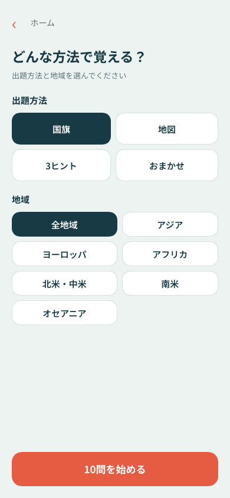
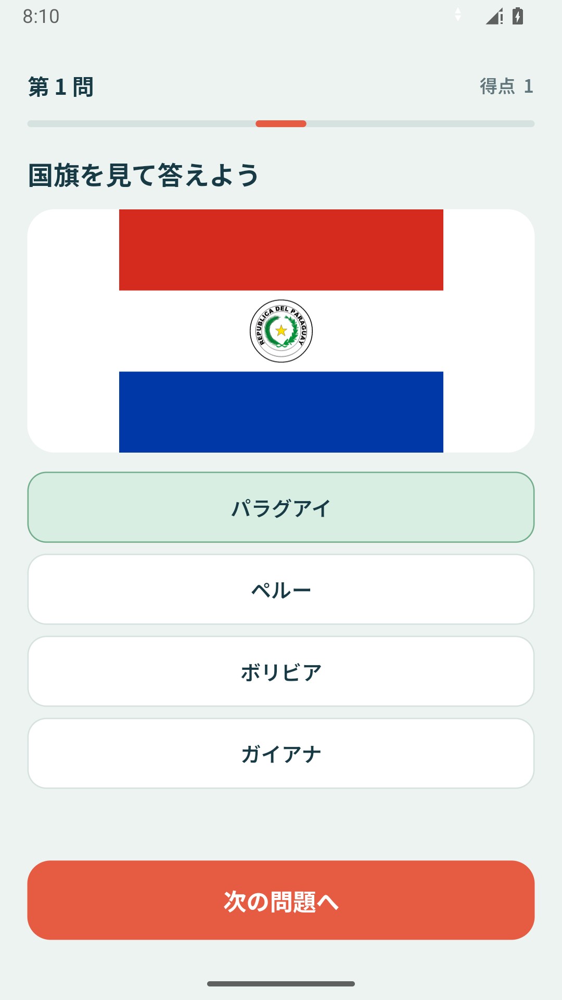
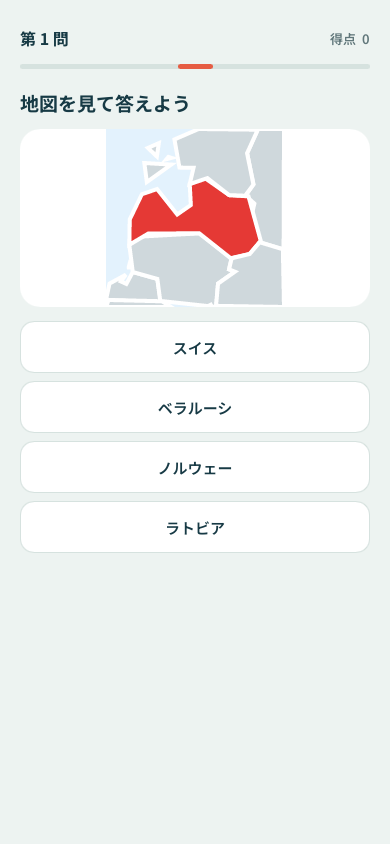
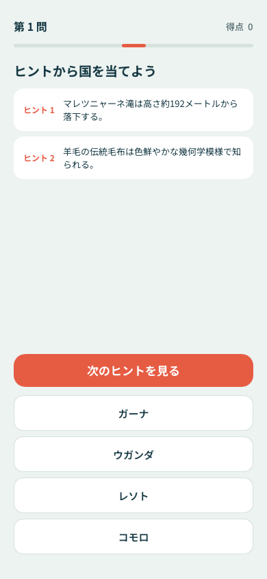
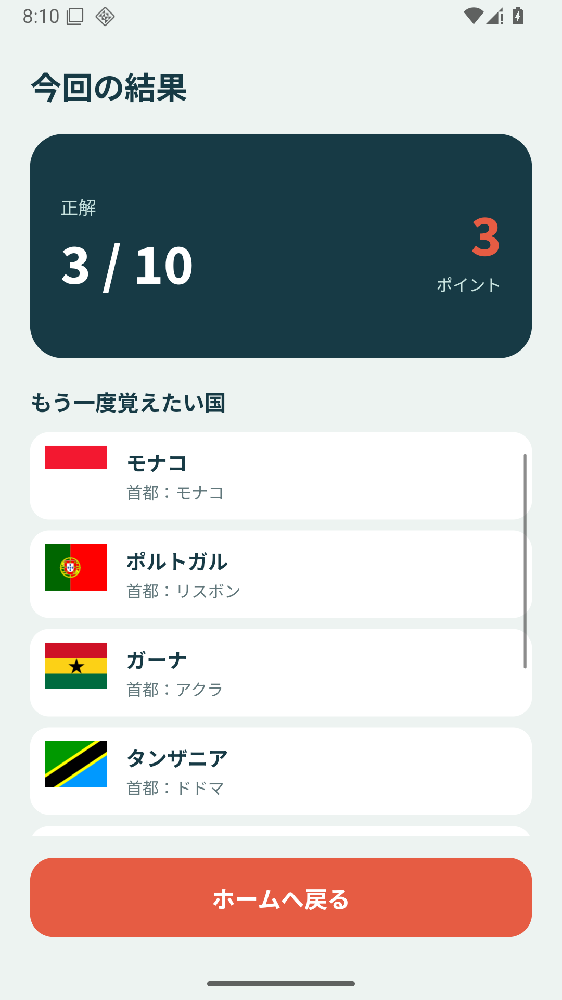

# 国あんき

A Japanese country quiz built with Rust and Slint.

During a quiz, **中断** asks for confirmation. Answered progress is kept; an unfinished question is discarded.

| Home (iOS) | Mode select (Android) | Flag quiz (Android) |
| :---: | :---: | :---: |
|  |  |  |
| **Map quiz (Android)** | **Trivia quiz (Android)** | **Result (Android)** |
|  |  |  |

Captured from an iPhone 17 Simulator (iOS 26.5) and an API 36 Android Emulator. Additional native captures: [iPhone flag](docs/screenshots/ios-flag.png), [iPhone result](docs/screenshots/ios-result.png), [iPad home](docs/screenshots/ipad-home.png), [iPad quiz](docs/screenshots/ipad-quiz.png).
Map questions expand into the available quiz area. Use the on-screen zoom and reset controls or drag to pan; zoom tops out at 300%, with larger maps capped so the zoomed map stays within 1600 logical pixels when possible. Pinch zoom is not supported.
Flag images have a subtle frame in both questions and results, keeping white edges visible.

## Run on desktop

```sh
cargo run
```

Edit `ui/app-window.slint` to change the interface. Install `slint-lsp` and use the [Slint editor integration](https://github.com/slint-ui/slint/tree/master/tools/lsp) for formatting and language support.

On Debian or Ubuntu, install `build-essential`, `libxcb-shape0-dev`, `libxcb-xfixes0-dev`, `libxkbcommon-dev`, `libfontconfig-dev`, `libinput10`, `libgbm1`, and `libasound2-dev` (for audio support).

## Sound effects

Enabled buttons play a soft tap. Accepted answers play distinct correct or incorrect sounds instead of a tap. The final Next button triggers both a tap and a short arpeggio as the results open.

The sounds are synthesized in Rust, with no bundled audio files and no in-app sound toggle. They follow device volume and stay silent when no output device is available. Sound effects are always disabled on iOS Simulator. On physical iOS devices, the Ambient audio category honors the Ring/Silent switch and mixes with other apps' audio. On Android, sounds follow media volume and do not request audio focus, so other apps' music keeps playing.

## Tests

Run unit and headless end-to-end tests with `cargo test`. To run just the saved Slint UI suite, use `cargo test --locked --all-features --test e2e`. The suite drives the real UI callbacks with seeded rounds and isolated progress files. Its sound assertions check the effects requested by each action, not speaker output. Unit tests cover the synthesized samples separately.

Android smoke tests run on an API 36 Emulator in CI. Logs, screenshots, and first-tap window/input diagnostics are attached to the workflow run, including failures.

Check that smoke startup failures produce a nonzero exit status without an SDK or device:

```sh
python3 -m unittest discover -s scripts -p test_android_smoke.py
```

Slint 1.18.1's `android-activity` backend does not expose native Android accessibility nodes, so TalkBack is not supported. This is a backend limitation, not a missing button label in the app.

The Android test build exposes the live Slint scene over loopback MCP for element lookup. Input still uses native `adb` taps, and screenshots come from the Emulator. Only the opt-in debug build enables this server:

```sh
./android/gradlew -p android :app:assembleDebug -Pkunianki.androidAbi=x86_64 -Pkunianki.androidSmoke=true
python3 scripts/android_smoke.py
```

Run this only with a dedicated Emulator. Do not distribute smoke builds; ordinary release builds do not include the test server or wrapper.

### iOS Simulator UI smoke

On Apple Silicon with Xcode, XcodeGen, the `aarch64-apple-ios-sim` Rust target, and a dedicated booted iOS Simulator, set `SMOKE_DEVICE` to its UDID. Build a test-only app with a fresh bundle ID so each run starts with empty progress:

```sh
(cd ios && xcodegen generate)
xcodebuild -project ios/kunianki.xcodeproj -scheme kunianki -sdk iphonesimulator \
  -configuration Debug -destination "platform=iOS Simulator,id=$SMOKE_DEVICE" \
  -derivedDataPath "$PWD/target/ios-smoke-build" CODE_SIGNING_ALLOWED=NO ARCHS=arm64 build
SLINT_EMIT_DEBUG_INFO=1 cargo build --locked --target aarch64-apple-ios-sim \
  --features slint/mcp --bin kunianki
SMOKE_DIR=$(mktemp -d "$PWD/target/ios-smoke.XXXXXX")
SMOKE_ID="dev.kunianki.app.smoke.$(uuidgen)"
SMOKE_PORT=19317
SMOKE_APP="$SMOKE_DIR/kunianki.app"
ditto target/ios-smoke-build/Build/Products/Debug-iphonesimulator/kunianki.app "$SMOKE_APP"
cp target/aarch64-apple-ios-sim/debug/kunianki "$SMOKE_APP/kunianki"
/usr/libexec/PlistBuddy -c "Set :CFBundleIdentifier $SMOKE_ID" "$SMOKE_APP/Info.plist"
codesign --force --sign - "$SMOKE_APP"
xcrun simctl install "$SMOKE_DEVICE" "$SMOKE_APP"
SIMCTL_CHILD_SLINT_MCP_PORT=$SMOKE_PORT xcrun simctl launch \
  --stdout="$SMOKE_DIR/stdout.log" --stderr="$SMOKE_DIR/stderr.log" "$SMOKE_DEVICE" "$SMOKE_ID"
```

Once `stderr.log` says the server is listening, run the suite and stop the test app:

```sh
python3 scripts/ios_smoke.py --device "$SMOKE_DEVICE" --port "$SMOKE_PORT" \
  --output "$SMOKE_DIR/screenshots"
xcrun simctl terminate "$SMOKE_DEVICE" "$SMOKE_ID"
```

The suite uses Slint's test input on the native simulator app and saves simulator framebuffer screenshots. It checks a complete flag round, the disabled review tile, and quit/resume, not system-level touch delivery or audible output.

## Assets and release

Trivia references are recorded per hint in `data/sources/`. Keep these URLs in the same order as each country's `trivia_ja` entries.

The bundled Noto Sans JP font contains only the characters used by the app. After changing UI, country data, or the privacy text, regenerate it and check coverage:

```sh
uv run --with-requirements scripts/requirements-assets.txt python scripts/subset_font.py --fetch-source
uv run --with-requirements scripts/requirements-assets.txt python scripts/subset_font.py --check
```

The upstream font URL and checksum are pinned in the script. `assets/fonts/OFL.txt` retains its license. App icons and launch artwork are generated from `assets/icons/master.svg` by `scripts/gen_icons.py`.

See [release and store submission](docs/release.md) for signed AAB/iOS archives, store artwork, metadata, and the account-owner requirements. See the [privacy policy](docs/privacy.md) for local progress and answer-history files and backups.

## Build for iOS

Install Xcode and [XcodeGen](https://github.com/yonaskolb/XcodeGen), then add the Rust targets:

```sh
rustup target add aarch64-apple-ios aarch64-apple-ios-sim
cd ios
xcodegen generate
open kunianki.xcodeproj
```

Build and run the generated project from Xcode.

For Intel-based simulator builds, also install the `x86_64-apple-ios` Rust target.

## Build for Android

Install Android Studio's Android SDK and NDK, then install [`cargo-ndk`](https://github.com/bbqsrc/cargo-ndk) and the Rust target. The Gradle wrapper in `android/` downloads the required Gradle version (JDK 17 or newer):

```sh
rustup target add aarch64-linux-android
cargo install cargo-ndk
export ANDROID_HOME="$HOME/Library/Android/sdk"
export ANDROID_NDK_HOME="$ANDROID_HOME/ndk/<installed-version>"
./android/gradlew -p android :app:assembleDebug
```

Set `ANDROID_HOME` and `ANDROID_NDK_HOME` to the SDK/NDK locations on your machine. The Gradle task builds the Rust library for `arm64-v8a` and packages it with the Android application.

## Mobile smoke checklist

Re-run these checks after app changes. Native interaction has been exercised on iPhone 17 and iPad Pro 13-inch Simulators (iOS 26.5), and an API 36 x86_64 Android Emulator in CI. Physical devices have not been tested.

- [ ] iOS simulator: run `xcodegen generate` in `ios/`, then build and launch from Xcode. Sound output is disabled on the simulator because an unavailable audio service can abort app startup. Use a physical iOS device for the audio checks below.
- [ ] Android emulator: run `./android/gradlew -p android :app:installDebug -Pkunianki.androidAbi=x86_64` for an x86_64 Emulator, then launch the app. Omit the ABI property for an arm64-v8a device.
- [ ] Confirm the app launches and Japanese text renders correctly.
- [ ] Confirm flag and map questions display their images.
- [ ] Answer questions, restart the app, and confirm progress persists.
- [ ] Answer incorrectly and confirm the review count updates.
- [ ] With audio enabled, press a navigation button, submit a correct and an incorrect answer, and advance to the results screen. Confirm the tap, answer, and round-completion sounds are distinct. Dragging a map and pressing a disabled control should remain silent.
- [ ] iOS: Turn on the Ring/Silent switch and confirm the quiz is silent. Turn it off, start music in another app, and confirm quiz sounds mix in without interrupting the music.
- [ ] Android: Start music in another app and confirm it keeps playing during quiz sounds. Adjust media volume and confirm it controls sound-effect loudness.
