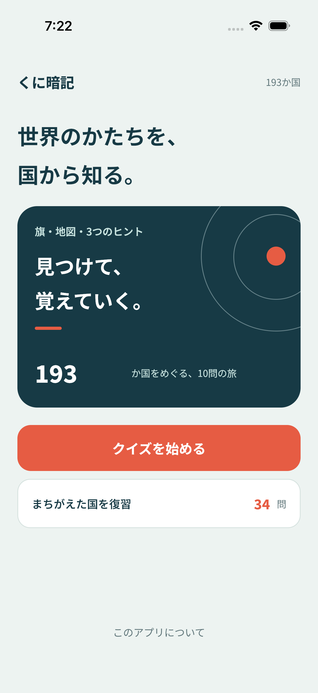
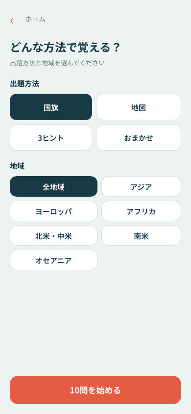
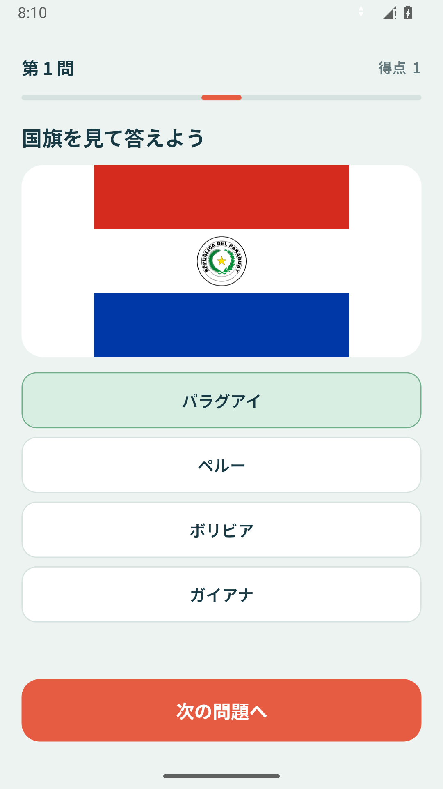
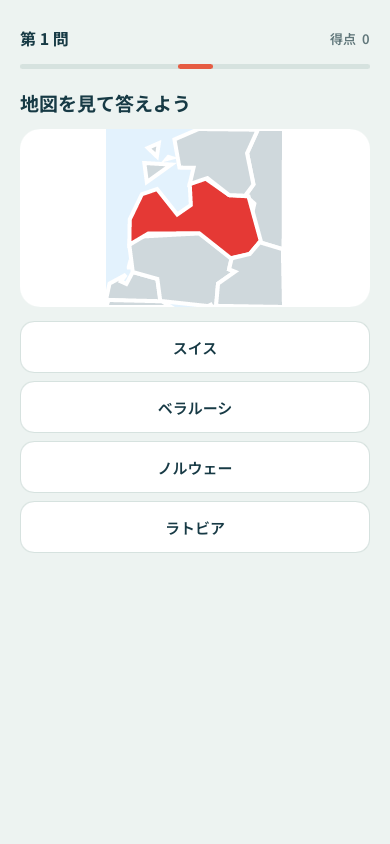
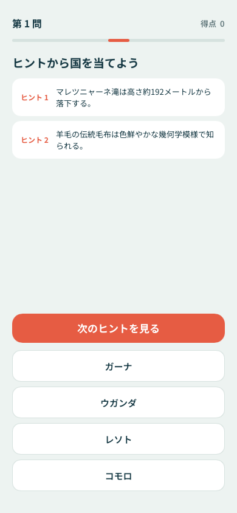
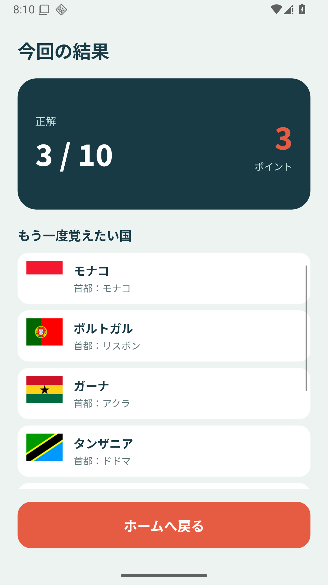

# kunianki

A Japanese country quiz built with Rust and Slint.

| Home | Mode select | Flag quiz |
| :---: | :---: | :---: |
|  |  |  |
| **Map quiz** | **Trivia quiz** | **Result** |
|  |  |  |

## Run on desktop

```sh
cargo run
```

Edit `ui/app-window.slint` to change the interface. Install `slint-lsp` and use the [Slint editor integration](https://github.com/slint-ui/slint/tree/master/tools/lsp) for formatting and language support.

On Linux, install `build-essential`, `libxcb-shape0-dev`, `libxcb-xfixes0-dev`, `libxkbcommon-dev`, `libfontconfig-dev`, `libinput10`, and `libgbm1`.

## Tests

Run unit and headless end-to-end tests with `cargo test`.

Android smoke tests run on an API 36 Emulator in CI. Logs and screenshots are attached to the workflow run, including failures.

Slint 1.18.1's `android-activity` backend does not expose native Android accessibility nodes, so TalkBack is not supported. This is a backend limitation, not a missing button label in the app.

The Android test build exposes the live Slint scene over loopback MCP for element lookup. Input still uses native `adb` taps, and screenshots come from the Emulator. Only the opt-in debug build enables this server:

```sh
./android/gradlew -p android :app:assembleDebug -Pkunianki.androidAbi=x86_64 -Pkunianki.androidSmoke=true
python3 scripts/android_smoke.py
```

Run this only with a dedicated Emulator. Do not distribute smoke builds; ordinary release builds do not include the test server or wrapper.

## Assets and release

Trivia references are recorded per hint in `data/sources/`. Keep these URLs in the same order as each country's `trivia_ja` entries.

The bundled Noto Sans JP font contains only the characters used by the app. After changing UI, country data, or the privacy text, regenerate it and check coverage:

```sh
uv run --with-requirements scripts/requirements-assets.txt python scripts/subset_font.py --fetch-source
uv run --with-requirements scripts/requirements-assets.txt python scripts/subset_font.py --check
```

The upstream font URL and checksum are pinned in the script. `assets/fonts/OFL.txt` retains its license. App icons and launch artwork are generated from `assets/icons/master.svg` by `scripts/gen_icons.py`.

See [release and store submission](docs/release.md) for signed AAB/iOS archives, store artwork, metadata, and the account-owner requirements. See the [privacy policy](docs/privacy.md) for local progress storage and backups.

## Build for iOS

Install Xcode and [XcodeGen](https://github.com/yonaskolb/XcodeGen), then add the Rust targets:

```sh
rustup target add aarch64-apple-ios aarch64-apple-ios-sim
cd ios
xcodegen generate
open kunianki.xcodeproj
```

Build and run the generated project from Xcode.

For Intel-based simulator builds, also install the `x86_64-apple-ios` Rust target.

## Build for Android

Install Android Studio's Android SDK and NDK, then install [`cargo-ndk`](https://github.com/bbqsrc/cargo-ndk) and the Rust target. The Gradle wrapper in `android/` downloads the required Gradle version (JDK 17 or newer):

```sh
rustup target add aarch64-linux-android
cargo install cargo-ndk
export ANDROID_HOME="$HOME/Library/Android/sdk"
export ANDROID_NDK_HOME="$ANDROID_HOME/ndk/<installed-version>"
./android/gradlew -p android :app:assembleDebug
```

Set `ANDROID_HOME` and `ANDROID_NDK_HOME` to the SDK/NDK locations on your machine. The Gradle task builds the Rust library for `arm64-v8a` and packages it with the Android application.

## Mobile smoke checklist

- [ ] iOS simulator: run `xcodegen generate` in `ios/`, then build and launch from Xcode.
- [ ] Android emulator: run `./android/gradlew -p android :app:installDebug` from the repo root, then launch the app.
- [ ] Confirm the app launches and Japanese text renders correctly.
- [ ] Confirm flag and map questions display their images.
- [ ] Answer questions, restart the app, and confirm progress persists.
- [ ] Answer incorrectly and confirm the review count updates.
